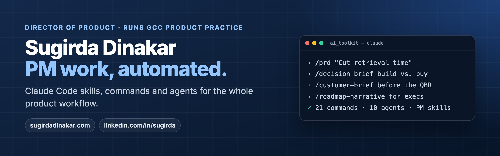

### Hi, I'm Sugirda

I'm Director of Product at Reveleer. I lead products where being wrong has a real cost, and I run our India GCC product practice: 5 PMs working follow-the-sun across three time zones.

I build and curate Claude Code skills, commands and agents to automate my own PM work, and I share them here.

### Start here

**[ai_toolkit](https://github.com/sugirdadinakar/ai_toolkit)**: a product-management toolkit for Claude Code, covering the whole PM workflow.

- **21 slash commands** such as `/prd`, `/decision-brief`, `/customer-brief`, `/discovery`, `/roadmap-narrative` and `/sprint-health`
- **10 agents**, including a PRD reviewer, a CPTO-style reviewer, voice of the customer, market research and a prototype builder
- **Skills** for research synthesis, impact sizing, interview analysis and stakeholder-ready narratives

### Also here

**[AI-for-Product-Managers](https://github.com/sugirdadinakar/AI-for-Product-Managers)**: my copy of [ombharatiya's guide](https://github.com/ombharatiya/AI-for-Product-Managers) to becoming an AI product manager. All credit goes to the original author.

### Find me

[Portfolio](https://sugirdadinakar.com) · [LinkedIn](https://www.linkedin.com/in/sugirda) · [Email](mailto:sugirda@gmail.com)
